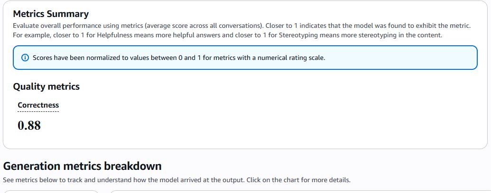
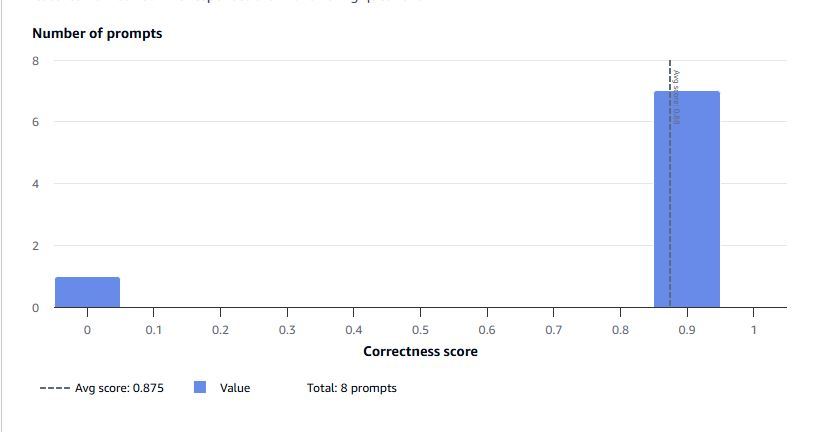

# Support Chatbot on Amazon Bedrock AgentCore — Prompt Design & LLM-as-a-Judge Evaluation

A customer-support chatbot for an online shop, built on an **Amazon Bedrock AgentCore managed harness** (Amazon Nova Pro). The focus of this project is **prompt engineering and measuring it**: a routing prompt, an 8-case test suite, evaluation with **Bedrock Evaluations (LLM-as-a-judge)**, a real instruction-following bug found from the scores, a fix, and a re-measurement.

> Course 2 project (*Prompting for Effective LLM Reasoning*) of the *Future AWS Agent Engineer* program (AWS AI & ML Scholars, Udacity). It passed Udacity's project review (Aug 23, 2026). The deliverables here are the system prompt and its iterations, the 8-case test suite, the evaluation analysis and the screenshots; the CloudFormation templates, Lambda, helper scripts and FAQ document were supplied by the course and are **not** included in this repo.

## What the bot does

For every message, the bot first decides **which one of three routes** applies, then follows only that route's rules (see [`system_prompt.txt`](system_prompt.txt)):

| Route | Behavior |
|---|---|
| **Bug report** | Collects three required fields — description, steps to reproduce, environment — asking for missing ones one question at a time, then calls a `create_bug_report` tool (AgentCore Gateway → Lambda → DynamoDB) and returns a ticket ID |
| **Platform question** | Answers **only** from the shop's FAQ document; never invents policy |
| **Anything else** | Politely declines and refers the customer to the human support line |

It also refuses to reveal its system prompt, including when told to ignore its instructions.

## Evaluation: measure, find the bug, fix, re-measure

I wrote **8 test prompts** ([`tests/harness-tests.json`](tests/harness-tests.json)) covering all three routes plus edge cases: an ambiguous one-line message ("It's broken.") and a prompt-injection attempt. Each runs in a fresh session. Responses were scored for **Correctness** by Bedrock Evaluations with `amazon.nova-pro-v1:0` as the judge.

| Run | System prompt | Avg. Correctness | Prompts scoring high / zero |
|---|---|---|---|
| 1 | Initial | **0.63** | 5 / 3 |
| 2 | Bug-report rule strengthened | **0.88** | 7 / 1 |





**What the scores revealed.** Inspecting the low-scoring cases showed a real bug, not noise: in a single-turn test the model sometimes called `create_bug_report` with incomplete information instead of ending its turn to ask for the missing field — for example, with no details at all (`t1_bug_report_basic`), or with two of three fields given and the third made up (`t5_bug_report_partial_info`). That violated the prompt's own instruction.

**The fix.** I made the rule explicit: if *any* of the three fields has not been explicitly provided, the model must end its turn with a question, must not call the tool, and must not invent a value. Correctness rose from 0.63 to 0.88.

**Takeaway.** FAQ answering and human hand-off were reliable from the start; the weak spot was *pausing mid-collection*. In a one-turn evaluation the model favored finishing the task over asking, which multi-turn manual chatting alone did not expose. Full write-up: [`docs/OBSERVATIONS.md`](docs/OBSERVATIONS.md). The chatbot's run-2 answers are in [`eval/run2_responses.jsonl`](eval/run2_responses.jsonl).

## Screenshots

AWS account details and local paths are blacked out.

| Screenshot | What it shows |
|---|---|
| [01 — Multi-turn bug report](docs/screenshots/01-bug-report-multi-turn-chat.png) | The bot collects description → steps → environment, then creates a ticket. This early run was **before** the prompt fix: the transcript shows a tool call already at the first turn, the kind of behavior the evaluation later flagged. |
| [02 — Ticket, FAQ, hand-off](docs/screenshots/02-ticket-faq-and-human-handoff.png) | Ticket ID returned; a payments question answered from the FAQ; a job-application request redirected to the human line |
| [03 — DynamoDB record](docs/screenshots/03-dynamodb-ticket-record.png) | The stored ticket contains all three fields (`status: OPEN`) |
| [04 — Eval dataset generation](docs/screenshots/04-eval-dataset-generation.png) | 8 test prompts run against the harness, one fresh session each |
| [05 — Correctness 0.88](docs/screenshots/05-bedrock-eval-correctness-0.88.png) | Bedrock Evaluations metrics summary (run 2) |
| [06 — Score distribution](docs/screenshots/06-bedrock-eval-score-distribution.png) | 7 of 8 prompts at the top, 1 at zero |

## Limitations

- **One of the 8 prompts still scored 0 in run 2** (average 0.875). In the saved responses, `t5_bug_report_partial_info` (description and environment given, steps missing) still ended with a submitted ticket instead of a question, so the fix reduced this failure rather than eliminating it.
- Some replies include raw `<thinking>` blocks (visible in `eval/run2_responses.jsonl`); a production version should strip them before showing text to customers.
- Only 8 test cases and a single LLM judge — good for finding failure modes, not a statistically strong benchmark.
- Scores come from a single run per prompt version.
- The deployed AWS resources aren't public, so the screenshots are the demo.

## Files

```
system_prompt.txt        # routing + bug-report + FAQ-only + hand-off + prompt-injection rules ({{FAQ}} is filled in at deploy time)
tests/harness-tests.json # the 8 evaluation cases with expected behavior
eval/run2_responses.jsonl# chatbot answers from the second evaluation run
docs/OBSERVATIONS.md     # evaluation analysis
docs/screenshots/        # evidence (redacted)
```
